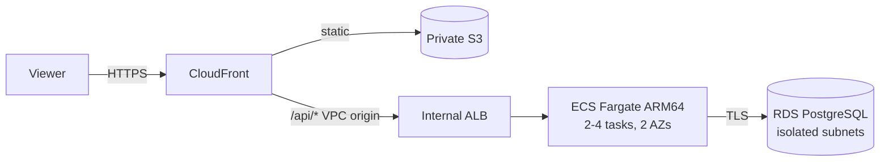

# AWS Well-Architected Three-Tier Application

A production-style three-tier web application on AWS, built with Terraform and reviewed against all six pillars of the AWS Well-Architected Framework. It serves HTTPS **without owning a domain**, has no public load balancer, and deploys from GitHub Actions with no stored AWS keys.




## Highlights

- **Three tiers:**
  - presentation: CloudFront and a private S3 bucket behind Origin Access Control;
  - application: an internal ALB and ECS Fargate on Graviton;
  - data: RDS PostgreSQL 16 in subnets with no internet route.
- **HTTPS with no domain:** CloudFront's default certificate, with an internal ALB reached through a CloudFront VPC origin ([ADR-0002](docs/adr/0002-cloudfront-vpc-origin.md)). A custom domain is optional.
- **Least privilege:**
  - GitHub OIDC with a read-only plan role and a deploy role that can only create IAM roles carrying a permissions boundary ([ADR-0003](docs/adr/0003-bounded-deploy-role.md));
  - the ECS task role has no permissions;
  - the database password is generated by RDS and injected from Secrets Manager.
- **Safe releases:**
  - immutable image tags;
  - Trivy image scan before push;
  - the plan is applied exactly as shown;
  - the ECS circuit breaker rolls back failed releases. There's a [game day](docs/game-day.md) to prove it.
- **Observability:**
  - CloudWatch dashboard;
  - 8 alarms (5xx, unhealthy targets, p95 latency, ECS CPU and memory, RDS CPU, connections, storage) sent to SNS email;
  - GuardDuty findings sent through EventBridge;
  - VPC flow logs, ALB access logs and structured app logs.
- **Cost control:**
  - about $3.25/day with defaults;
  - budget alerts;
  - one-click destroy;
  - switches for the fully resilient setup ([ADR-0004](docs/adr/0004-cost-defaults.md), [cost.md](docs/cost.md)).

## Security gates (every pull request)

Gitleaks · terraform fmt/validate · tflint (AWS ruleset) · Checkov (Terraform, GitHub Actions, Dockerfile) · Trivy config scan · ruff · pytest · pip-audit · a Terraform plan from the read-only role.

Local results:
- Checkov: 364 Terraform checks passed, 0 failed; 36 skips, each justified inline. GitHub Actions and Dockerfile checks: 0 failed.
- `terraform validate`: clean on both stacks.

## Docs

- [Architecture](docs/architecture.md)
- [Well-Architected review (6 pillars)](docs/well-architected.md)
- [Architecture decision records](docs/adr/)
- [Cost](docs/cost.md) · [Deploying](docs/deploy.md) · [Game day](docs/game-day.md)

## Layout

```
bootstrap/          state bucket, ECR, GitHub OIDC roles, permissions boundary (applied once by an admin)
modules/network     VPC, 3 subnet tiers x 2 AZs, NAT, S3 endpoint, data NACL, flow logs
modules/edge        CloudFront, S3 + OAC, VPC origin, optional WAF
modules/app         internal ALB, ECS cluster/service/task, autoscaling, IAM, logs
modules/data        RDS PostgreSQL, parameter group, security group, monitoring role
modules/observability  SNS, alarms, dashboard, GuardDuty, budget
envs/prod           root module
app/                FastAPI notes API (Python 3.13), tests, Dockerfile
frontend/           static page served from S3
```

## AI assistance

An AI assistant (Claude, Anthropic) helped write the code and documents. The author designed the system and reviewed the code and results.
