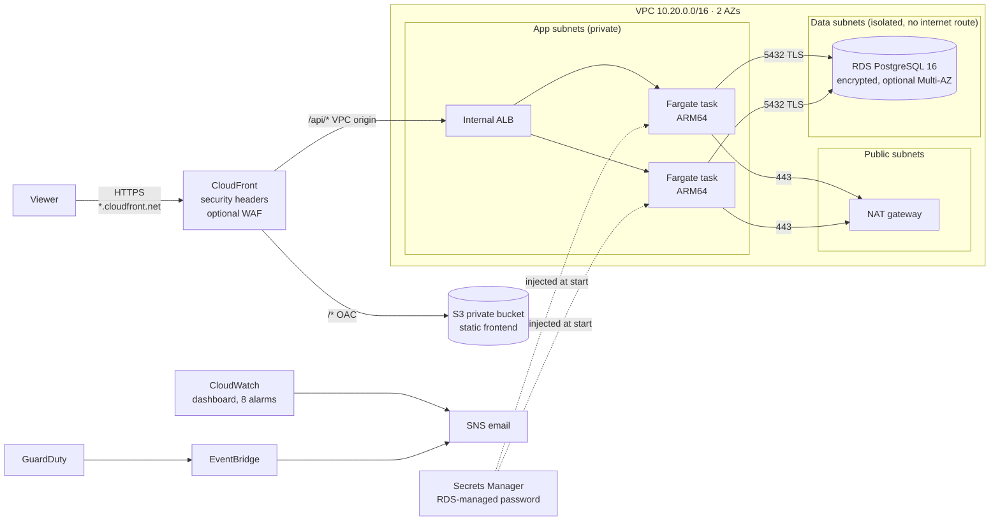

# Architecture



## Tiers

| Tier | Service | Placement | Reachable from |
|---|---|---|---|
| Presentation | CloudFront + private S3 bucket (Origin Access Control) | Global edge | Internet (HTTPS only) |
| Application | Internal ALB → ECS Fargate (ARM64), 2–4 tasks, autoscaling on CPU | App subnets, 2 AZs, no public IPs | CloudFront origin-facing range only (managed prefix list) |
| Data | RDS PostgreSQL 16, gp3, KMS-encrypted, `rds.force_ssl=1` | Data subnets, no route to the internet, NACL limited to VPC | Task security group only, port 5432 |

## Security groups (chained)

```
CloudFront prefix list --80--> ALB SG --8000--> Task SG --5432--> DB SG (no egress)
                                                Task SG --443--> 0.0.0.0/0 via NAT (ECR, Secrets Manager, Logs)
```

The default security group is emptied so nothing can use it by accident.

## Identity

| Principal | Permissions |
|---|---|
| GitHub plan role (PRs, `prod-plan` environment) | `ReadOnlyAccess` plus read/write on its own state key |
| GitHub deploy role (`prod` environment, required reviewers) | `PowerUserAccess` (no IAM) plus IAM limited to roles under `/app/three-tier/` that carry the workload permissions boundary ([ADR-0003](adr/0003-bounded-deploy-role.md)) |
| ECS execution role | Pull the image, write logs, read **one** secret and decrypt with **one** key |
| ECS task role | Nothing: the app calls no AWS APIs |
| Flow-log role, RDS monitoring role | Their service's minimum, inside the boundary |

## Data protection

- One customer-managed KMS key encrypts:
  - CloudWatch log groups;
  - the RDS storage;
  - the RDS master secret;
  - the SNS topic.
  Key rotation is on.
- The database password is generated, stored and rotated by RDS in Secrets Manager. It never appears in Terraform state, variables or the pipeline.
- TLS is used everywhere a client connects:
  - viewer to CloudFront (HTTP is redirected);
  - app to database (`sslmode=require` and `rds.force_ssl`).
  CloudFront to the ALB uses HTTP over the AWS network through a VPC origin ([ADR-0002](adr/0002-cloudfront-vpc-origin.md)).
- Every bucket blocks public access, enforces bucket-owner ownership and denies non-TLS requests.

## Release flow

```mermaid
sequenceDiagram
  participant Dev
  participant GH as GitHub Actions
  participant AWS
  Dev->>GH: pull request
  GH->>GH: gitleaks, fmt/validate/tflint, checkov, trivy config, app tests, pip-audit
  GH->>AWS: plan (read-only role)
  Dev->>GH: merge, run deploy (type "deploy")
  GH->>Dev: approve 'prod' environment?
  Dev-->>GH: approve
  GH->>AWS: build ARM64 image, Trivy scan, push (immutable tag = commit SHA)
  GH->>AWS: terraform plan -out, apply that plan
  AWS->>AWS: ECS rolling deploy; circuit breaker rolls back on failed health checks
  GH->>AWS: sync frontend, invalidate CloudFront, smoke test /api/healthz
```
